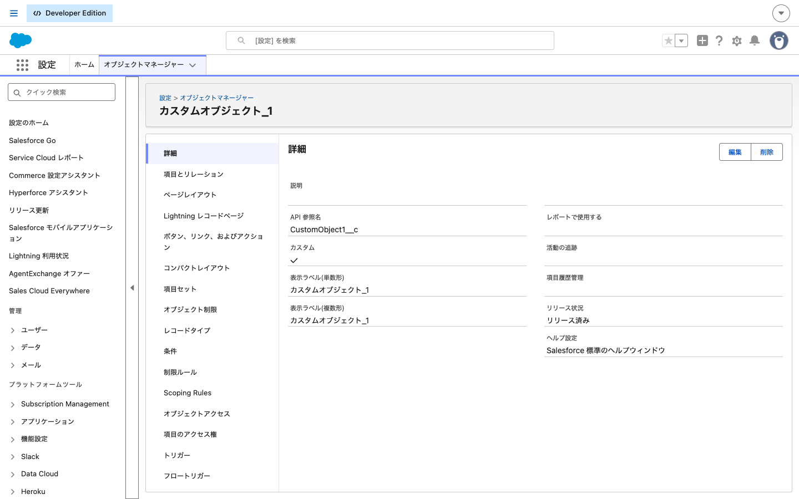
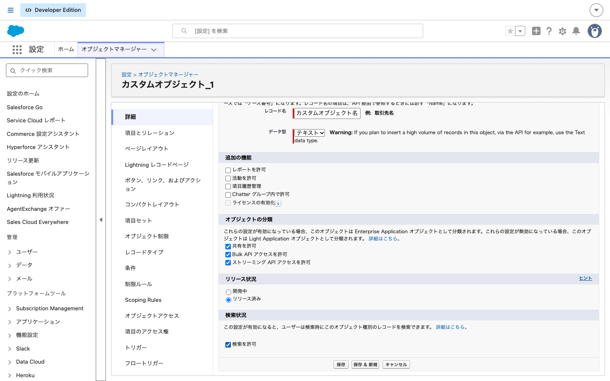
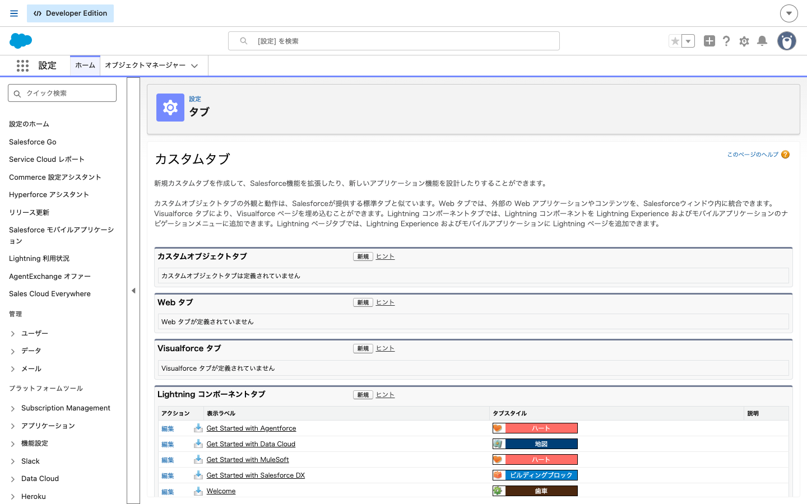
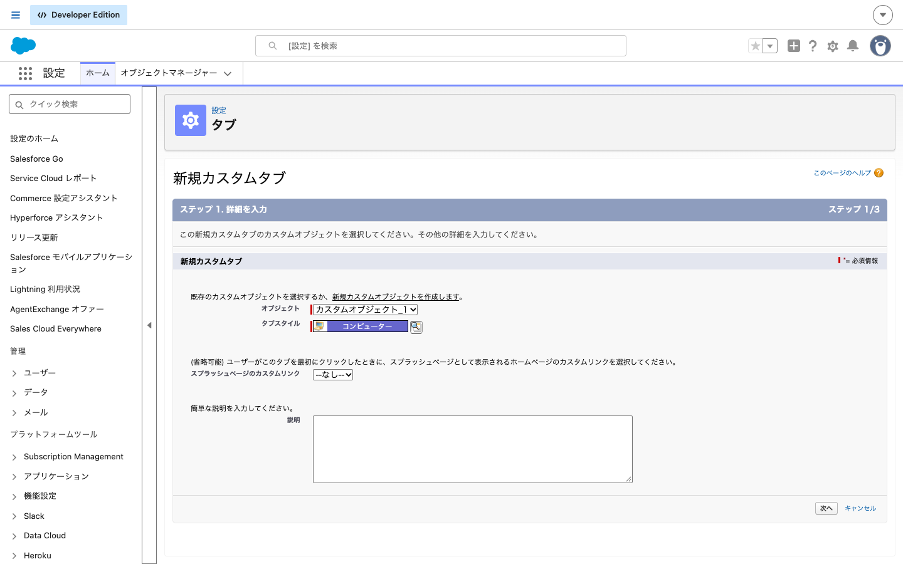
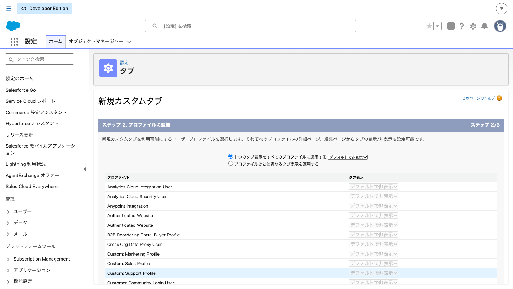
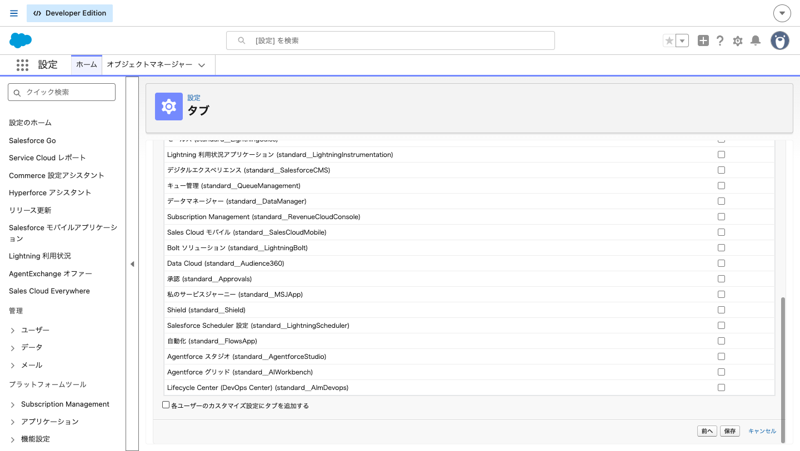
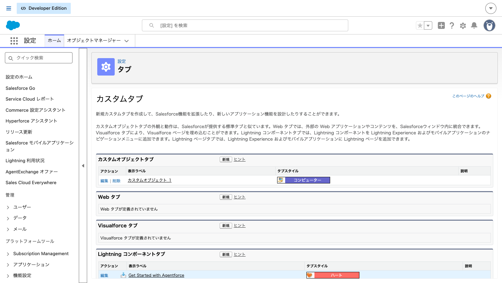
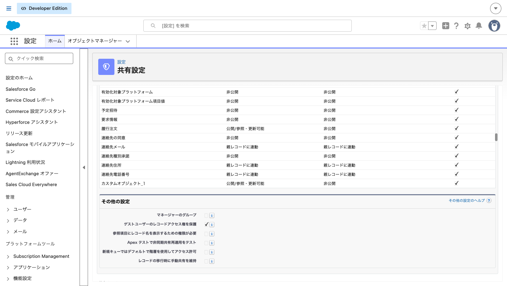
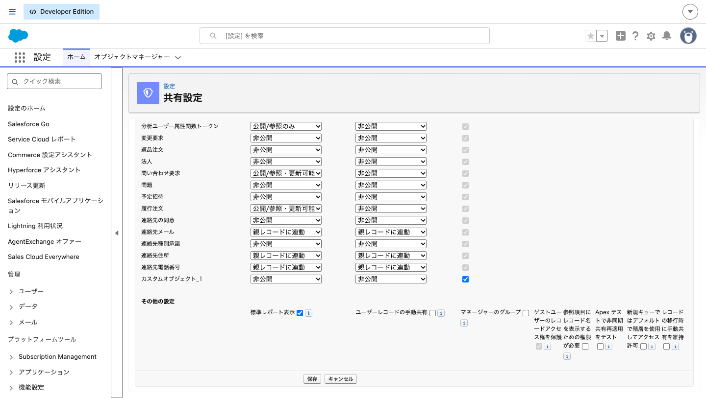
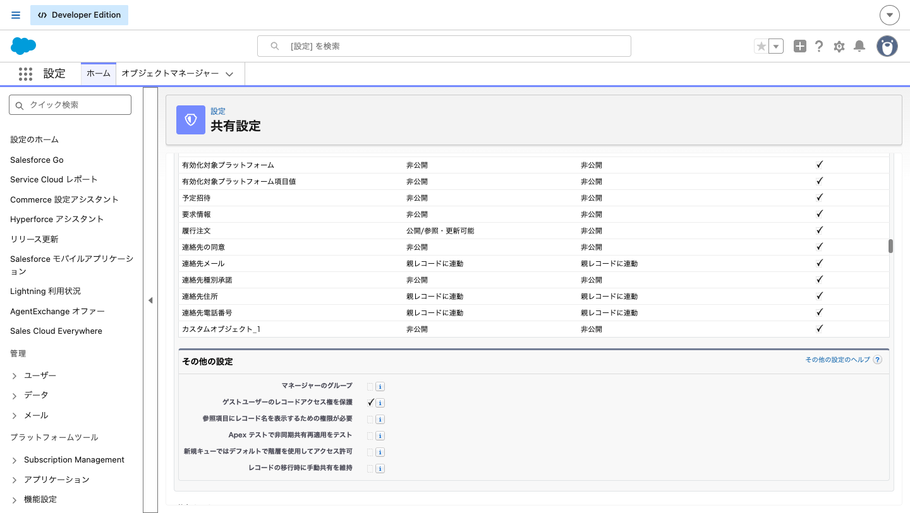

# 共有設定が非公開のカスタムオブジェクトを用意する手順

カスタムオブジェクト `CustomObject1__c`（カスタムオブジェクト_1）を、「アクセス権のないレコードが返らない」ことの確認に使えるようにする手順。共有設定を非公開にし、`find`（SOSL）と `listRecentSobjectRecords`（最近使ったレコード）の対象にもする。

- 対応するタスク: [tasks.md](../../openspec/changes/add-readonly-mcp-server/tasks.md) の 5.1・10.4
- 実施: 2026-11-22、組織 `handson`（Developer Edition）。画面の文言は、ユーザーの言語を日本語にしたときのもの

## 変更する設定

| 設定 | 変更前 | 変更後 | 目的 |
|---|---|---|---|
| オブジェクトの「検索を許可」 | オフ | オン | `find` で検索できるようにする |
| カスタムオブジェクトタブ | なし | あり（全プロファイルで「デフォルトで非表示」、どのアプリケーションにも入れない） | 最近使ったレコード（MRU）の記録を有効にする |
| 共有設定の「デフォルトの内部アクセス権」 | 公開/参照・更新可能 | 非公開 | 共有されていないレコードを作れるようにする |

この 3 つは `CustomObject1__c` にだけ効く。変更したメタデータ（オブジェクト・一覧ビュー・タブ）は、`force-app/main/default/objects/CustomObject1__c/` と `force-app/main/default/tabs/` に retrieve してある。

## 手順

### 1. 検索を許可する

1. 設定の「オブジェクトマネージャー」で「カスタムオブジェクト_1」を開き、「詳細」の「編集」を押す。

   

2. 「検索状況」の「**検索を許可**」にチェックを入れて「保存」を押す。「共有を許可」はすでにオンになっていることも確かめる（オフだと共有設定を非公開にできない）。

   

### 2. タブを作る

カスタムオブジェクトは、タブがないと最近使ったレコードが記録されない（describe の `mruEnabled` が `false` で、`LastViewedDate` の項目もない）。メニューを変えないよう、タブは作るが表示はしない。

1. 設定のクイック検索で「タブ」を開き、「カスタムオブジェクトタブ」の「新規」を押す。

   

2. ステップ 1: 「オブジェクト」で「カスタムオブジェクト_1」を選び、「タブスタイル」の虫眼鏡から任意のスタイル（ここでは「コンピューター」）を選んで「次へ」を押す。

   

3. ステップ 2: 「1 つのタブ表示をすべてのプロファイルに適用する」で「**デフォルトで非表示**」を選んで「次へ」を押す。

   

4. ステップ 3: 「タブを含める」のチェックをすべて外し、「各ユーザーのカスタマイズ設定にタブを追加する」も外して「保存」を押す。

   

「カスタムオブジェクトタブ」に「カスタムオブジェクト_1」が並べば完了。



作ったあとに describe で、`mruEnabled` と `searchable` が `true` になり、`LastViewedDate`・`LastReferencedDate` の項目ができたことを確かめる。

```sh
sf sobject describe --sobject CustomObject1__c --target-org handson --json
```

### 3. 共有設定を非公開にする

1. 設定のクイック検索で「共有設定」を開く。「組織の共有設定」の「カスタムオブジェクト_1」の行は、内部が「公開/参照・更新可能」、外部が「非公開」になっている。

   

2. 「組織の共有設定」の「編集」を押し、「カスタムオブジェクト_1」の「デフォルトの内部アクセス権」を「**非公開**」にして「保存」を押す。確認画面は出ない。

   

3. 一覧に戻り、内部・外部とも「非公開」になったことを確かめる。共有の再計算はバックグラウンドで行われる（レコードが 0 件だったので、すぐに反映された）。

   

「階層を使用したアクセス許可」はオンのまま（カスタムオブジェクトの既定）。ロール階層で上位のユーザーは、部下が所有するレコードを参照できるので、確認に使うユーザーの組み合わせに注意する。

## 元に戻すとき

逆の順に戻す。共有設定を「公開/参照・更新可能」に戻すと `CustomObject1__Share` がなくなる。Apex のテスト `ListRecentSobjectRecordsActionTest.shouldExcludeRecord_WhenAccessRevokedAfterViewing` はこのオブジェクトの共有設定が非公開であることを前提にしていて、戻すと前提の確認で失敗する。
