# Read Only Records Server を Setup で作る手順

読み取り専用のカスタム MCP サーバー `ReadOnlyRecordsServer` を Setup の画面で作り、3 つの Apex アクションをツールとして登録して、McpServerDefinition を retrieve するまでの手順と、ウィジェットを関連付けてからサーバーを有効にする手順。

- 対応するタスク: [tasks.md](../../openspec/changes/add-readonly-mcp-server/tasks.md) の 7.1・7.2（手順 1〜5）、9.3（手順 6）
- 根拠の設計: [design.md](../../openspec/changes/add-readonly-mcp-server/design.md) の D1・D5・D6
- 実施: 2026-11-21、組織 `handson`（Developer Edition）。画面の文言は、ユーザーの言語を日本語にしたときのもの

## 前提

- カスタム表示ラベルと、`SoqlQueryAction`・`FindAction`・`ListRecentSobjectRecordsAction` が組織にデプロイ済み（タスク 6.1）。`@InvocableMethod` のある Apex クラスだけがツールの候補に出る。
- システム管理者でログインしている。

## 設定する値

| 項目 | 値 |
|---|---|
| サーバーの表示ラベル | `Read Only Records Server` |
| サーバーの名前（API 参照名） | `ReadOnlyRecordsServer` |
| サーバーの説明 | `SOQL・SOSL・最近使ったレコードで Salesforce のレコードを読み取る、読み取り専用のサーバー。応答には機密情報の取り扱いの注意喚起が付く` |

| Apex アクション（クラス） | ツール表示ラベル・ツール名 |
|---|---|
| SOQL Query（`SoqlQueryAction`） | `soqlQuery` |
| Find（`FindAction`） | `find` |
| List Recent SObject Records（`ListRecentSobjectRecordsAction`） | `listRecentSobjectRecords` |

3 つのツールのアノテーションはすべて「参照のみ」と「冪等」をオン、「破壊的」と「オープンワールド」をオフにする。

## 手順

### 1. MCP サーバーの一覧を開く

1. 設定のクイック検索に `MCP` と入力する。
2. 「インテグレーション > API カタログ > **MCP サーバー**」を開く。

「Einstein > Agentforce レジストリ > 登録済み MCP サーバー」は別の画面なので間違えない。

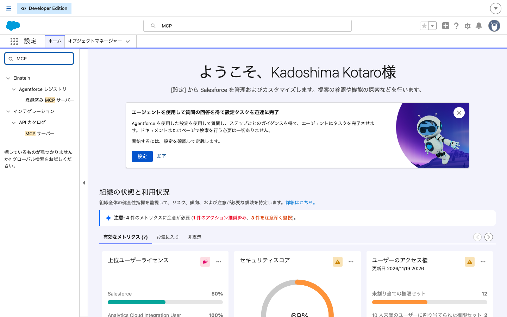

CLI から直接開く場合は `sf org open --target-org handson --path /lightning/setup/McpServer/home` を使う。

一覧には、標準のサーバー（SObject Reads など）と、作成済みのカスタムサーバーが並ぶ。画面上部には「Salesforce MCP サーバーの使用に対して請求される場合があります」（Flex Credits）という案内が出る。

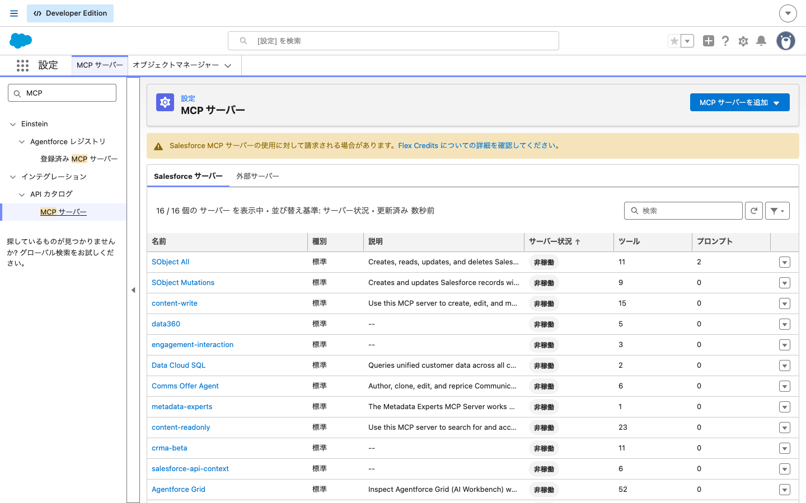

### 2. サーバーを作る

1. 右上の「MCP サーバーを追加 ▼」を押し、「**Salesforce MCP サーバーを作成**」を選ぶ（「外部 MCP サーバーを登録」ではない）。

   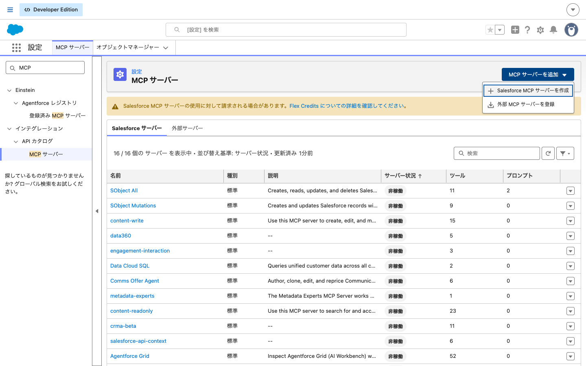

2. 「表示ラベル」に `Read Only Records Server` を入力する。フォーカスを外すと「名前」に `ReadOnlyRecordsServer` が自動で入るので、その値になっていることを確かめる。名前はあとから変更できない。
3. 「説明」を入力して「作成」を押す。説明は必須。

   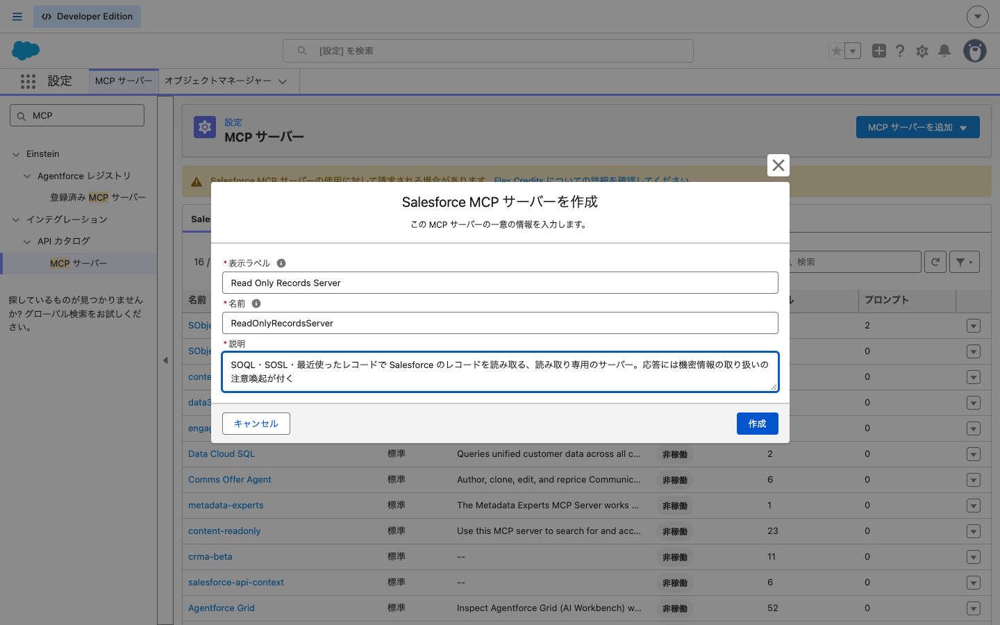

サーバーの詳細画面が開く。この時点ではサーバーは無効で、ツールは 0 件。

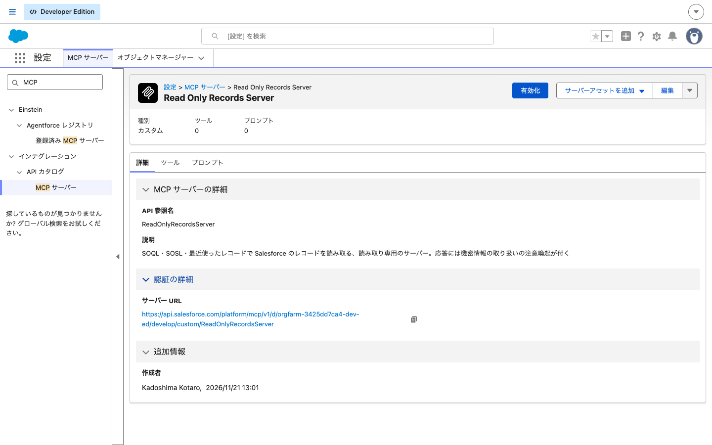

- 「認証の詳細」の「サーバー URL」は、MCP クライアントの接続先（タスク 10.1）。形は `https://api.salesforce.com/platform/mcp/v1/d/<My ドメインの組織部分>/develop/custom/ReadOnlyRecordsServer`。
- **ここでは「有効化」を押さない。** 有効にしたサーバーは、無効にするまで編集できない。リソース（ウィジェット）を関連付けたあと、タスク 9.3 で有効にする。

### 3. Apex アクションをツールとして追加する

1. 「サーバーアセットを追加 ▼」を押し、「**ツールを追加**」を選ぶ。

   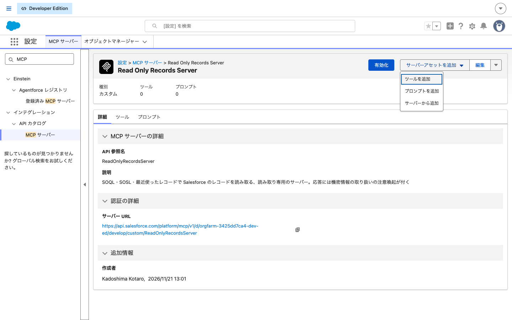

2. 「ツールを追加」の画面の左上の見出しは「Agentforce エージェント」になっている。横の ▼ を押して「**Apex アクション**」に切り替える。

   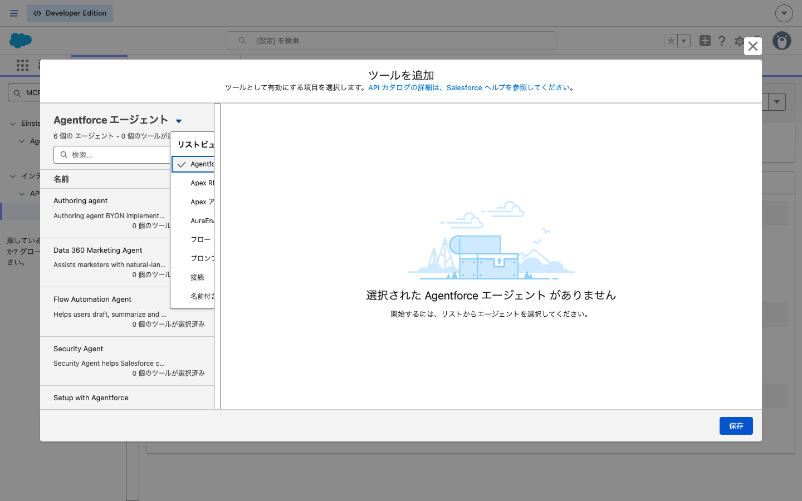

3. 一覧で「SOQL Query」を選び、右上の「**ツールを追加**」を押す。ボタンが「追加済み」に変わる。右側の入力スキーマで、入力が `query` 1 つだけであることも確かめられる。

   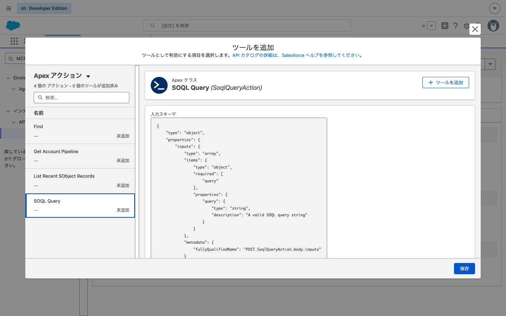

4. 「Find」と「List Recent SObject Records」も同じように追加する。「Get Account Pipeline」は既存の `HandsonPipelineServer` 用なので追加しない。
5. 3 つが「追加済み」になったら「保存」を押す。

   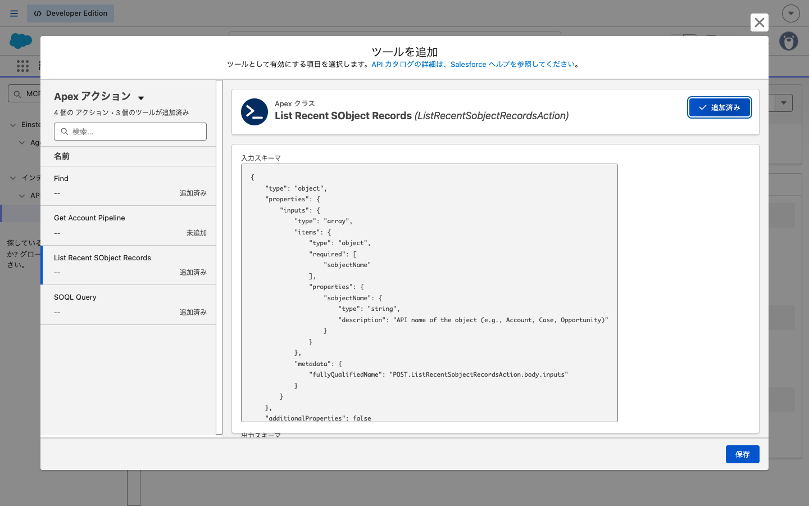

この画面ではツール名を設定できない。追加した時点のツール名は、Setup がクラス名から生成した名前になる（`SoqlQueryActionapex_SoqlQueryAction` など）。`ListRecentSobjectRecordsAction` の分は 64 文字で切れて `ListRecentSobjectRecordsActionapex_ListRecentSobjectRecordsActi` になる。

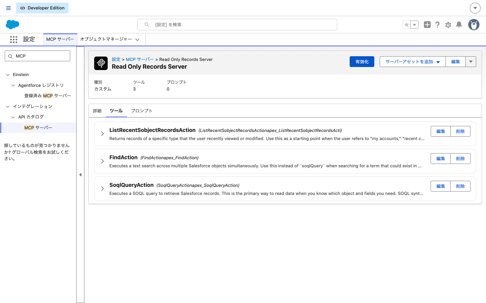

### 4. ツール名とアノテーションを設定する

サーバー詳細の「ツール」タブで、ツールごとに次の操作をする。

1. ツールの「編集」を押す。
2. 「操作名」（変更不可）を見て、どのクラスのツールかを確かめる。
3. 「ツール表示ラベル」と「ツール名」を、[設定する値](#設定する値)の表のとおりにする（例: `SoqlQueryAction` → `soqlQuery`）。
4. アノテーションの「参照のみ」と「冪等」にチェックを入れる。「破壊的」と「オープンワールド」はオフのまま。
5. 「説明」は変えない。sobject-reads の説明文が入っていて、そのまま使う（design D6）。
6. 「保存」を押す。

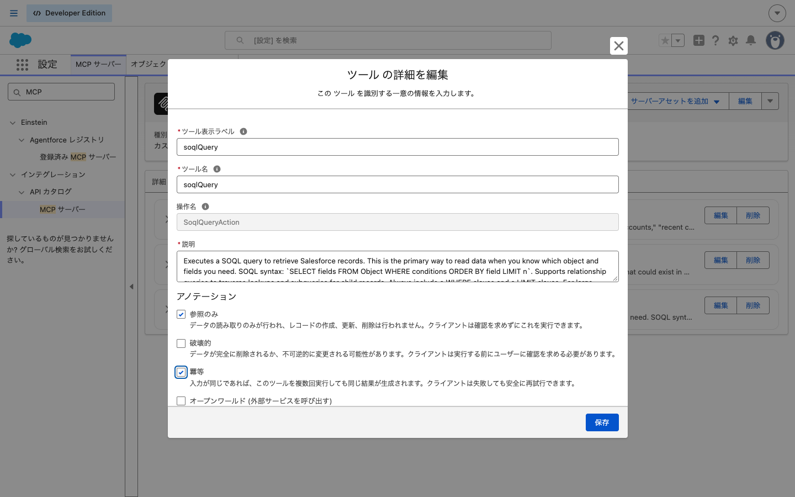

3 つとも設定すると、ツールタブに `listRecentSobjectRecords`・`find`・`soqlQuery` の 3 つが「参照のみ」「冪等」付きで並ぶ。

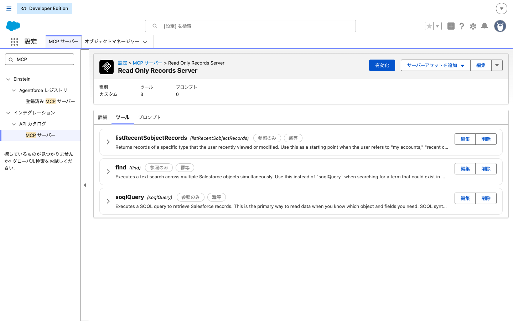

### 5. McpServerDefinition を retrieve する

プロジェクトのルートで次を実行する。

```sh
sf project retrieve start --metadata McpServerDefinition:ReadOnlyRecordsServer --target-org handson --json
```

`force-app/main/default/mcpServerDefinitions/ReadOnlyRecordsServer.mcpServerDefinition-meta.xml` ができる。3 つの `<tools>` が次の値になっていることを確かめる。

| `<toolName>` / `<toolTitle>` | `<apiIdentifier>` | `<operation>` |
|---|---|---|
| `soqlQuery` | `aa:apex-SoqlQueryAction` | `SoqlQueryAction` |
| `find` | `aa:apex-FindAction` | `FindAction` |
| `listRecentSobjectRecords` | `aa:apex-ListRecentSobjectRecordsAction` | `ListRecentSobjectRecordsAction` |

どのツールも `readOnly` と `idempotent` が `true`、`destructive`・`openWorld`・`returnDirect` が `false` になる。`<apiSource>` は `API_CATALOG`。`returnDirect` は画面に項目がなく、`false` のまま。

### 6. ウィジェットを関連付けてデプロイし、サーバーを有効にする

画面ではできない設定（ウィジェットの関連付け）を、retrieve した XML に入れてデプロイしてから、Setup でサーバーを有効にする。

#### 6-1. CLT とウィジェットをデプロイする（タスク 8.4）

参照される側から順にデプロイする。どれも先に `--dry-run` を付けて確かめる。

```sh
sf project deploy start --metadata LightningTypeBundle:soqlQueryResponse --metadata LightningTypeBundle:findResponse --metadata LightningTypeBundle:listRecentSobjectRecordsResponse --target-org handson --wait 30 --json
sf project deploy start --metadata UiWidgetBundle:dataHandlingNotice --target-org handson --wait 30 --json
sf project deploy start --metadata LightningTypeBundle:soqlQuery --metadata LightningTypeBundle:find --metadata LightningTypeBundle:listRecentSobjectRecords --target-org handson --wait 30 --json
```

#### 6-2. McpServerDefinition を編集してデプロイする（タスク 9.1・9.2）

`ReadOnlyRecordsServer.mcpServerDefinition-meta.xml` に次を足して、デプロイする。

- `<resources>` を 3 つ。`resourceName` はツール名と同じにし、`resourceUri` は `ui://widget/lightningType/c__<エンベロープ CLT 名>` にする。
- 各 `<tools>` に、対応する `resourceName` を指す `<uiResource>`。
`<descriptionOverride>` は Setup が入れた sobject-reads の説明文のまま変えない（design D6）。

```sh
sf project deploy start --metadata McpServerDefinition:ReadOnlyRecordsServer --target-org handson --wait 30 --json
```

Setup の画面では、有効なサーバーのツールを編集できない。メタデータのデプロイは、サーバーが有効なままでも通る（2026-11-21 に確認）。

デプロイしたあと、Setup のツールタブで、ツールの行の左の「>」を押すと、説明文・ソース・入出力スキーマを確認できる。

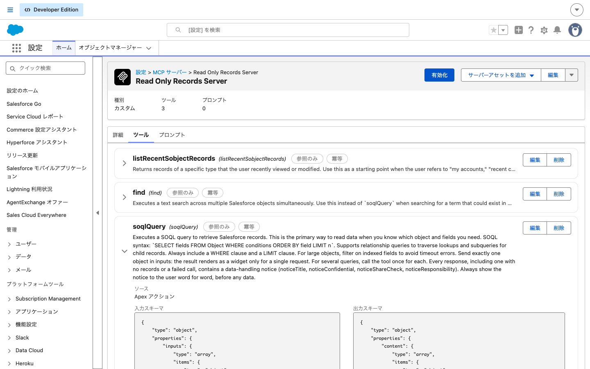

この画像は、説明文に注意喚起の伝達の指示を書き足していた時点のもの。指示はあとで外した（tasks 9.4）。

**Setup の画面には、ツールとリソース（ウィジェット）の関連付けが表示されない。** 関連付けが保存されたかどうかは、組織から retrieve し直し、3 つの `<uiResource>` と `<resources>` が入っていることで確かめる。作業用のフォルダに取り出すと、ローカルのファイルを上書きしない。

```sh
sf project retrieve start --metadata McpServerDefinition:ReadOnlyRecordsServer --target-org handson --target-metadata-dir <作業用のフォルダ> --unzip --json
```

組織が返す XML は、要素がアルファベット順になる（`<uiResource>` は `<toolTitle>` の後ろ、`<resources>` は `<tools>` の前）。ローカルのファイルもこの並びにしておくと、次の retrieve で差分が出ない。

#### 6-3. サーバーを有効にする（タスク 9.3）

1. MCP サーバーの一覧で「Read Only Records Server」を開く（一覧の検索欄に `Read Only` と入れると絞り込める）。
2. 右上の「**有効化**」を押す。確認画面は出ず、すぐに有効になる。

「MCP サーバー Read Only Records Server が有効化されました。」と表示され、ボタンが「無効化」に変わる。画面上部には「サーバーが有効な間は、アセットの編集、追加、削除はできません。」と表示される。

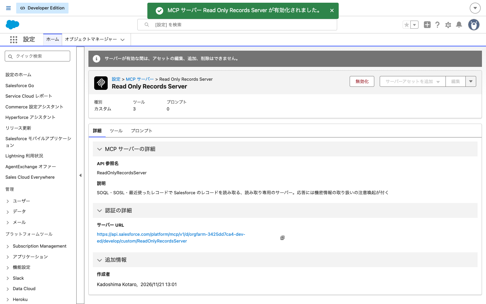

一覧では、サーバー状況が「稼働中」になる。

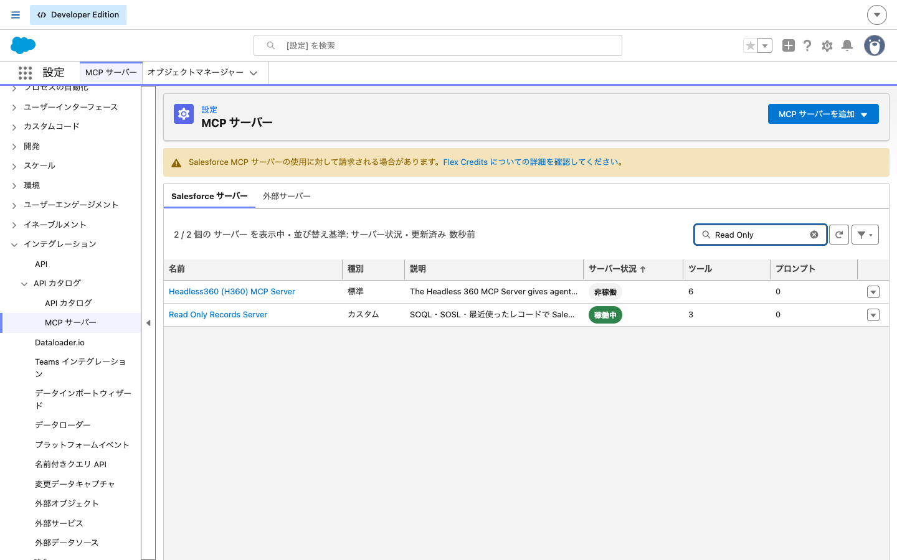

## このあとの作業

MCP クライアント（Claude Desktop など）から「サーバー URL」に接続して、受け入れ確認をする（タスク 10）。

## 元に戻すとき

- ツールを外す: サーバーを無効にしてから、ツールタブでそのツールの「削除」を押す。
- サーバーを使えなくする: サーバー詳細の「無効化」を押す。メタデータごと消す場合の順序は、design の Migration Plan のロールバックを参照。
